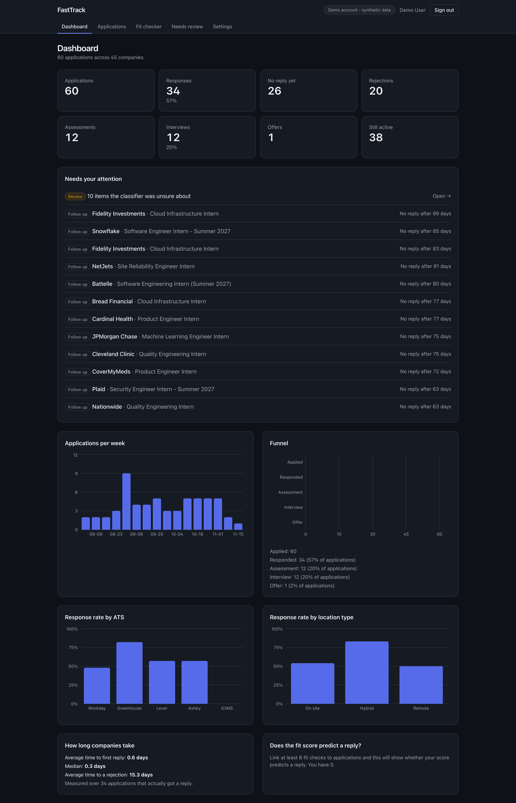
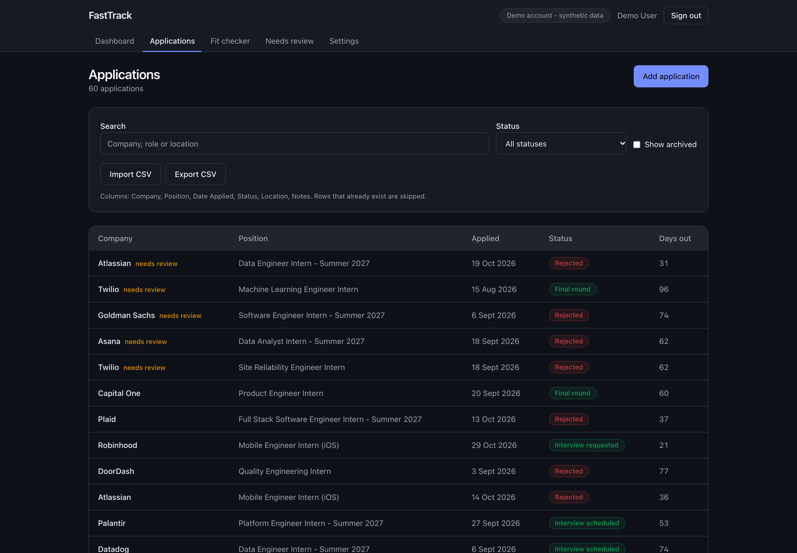
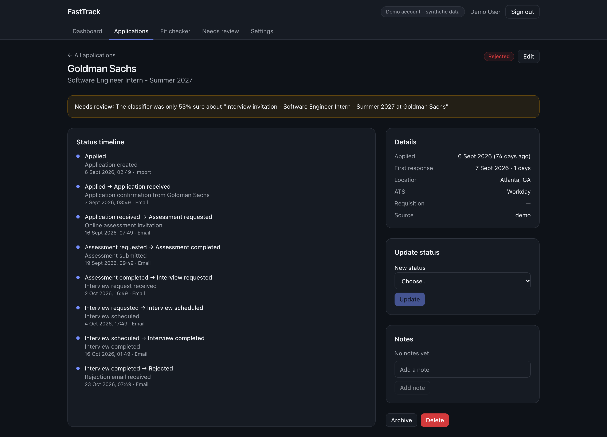
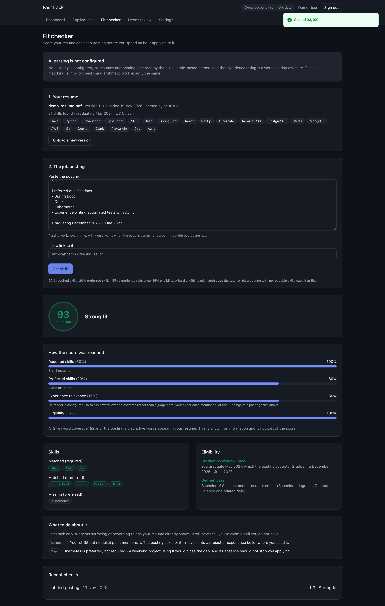
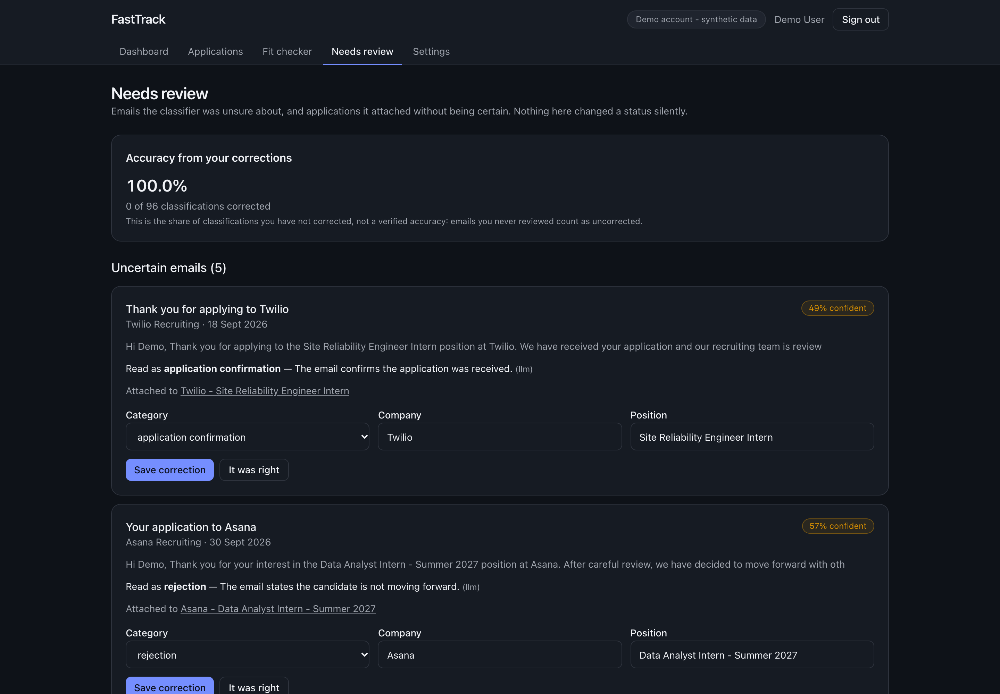
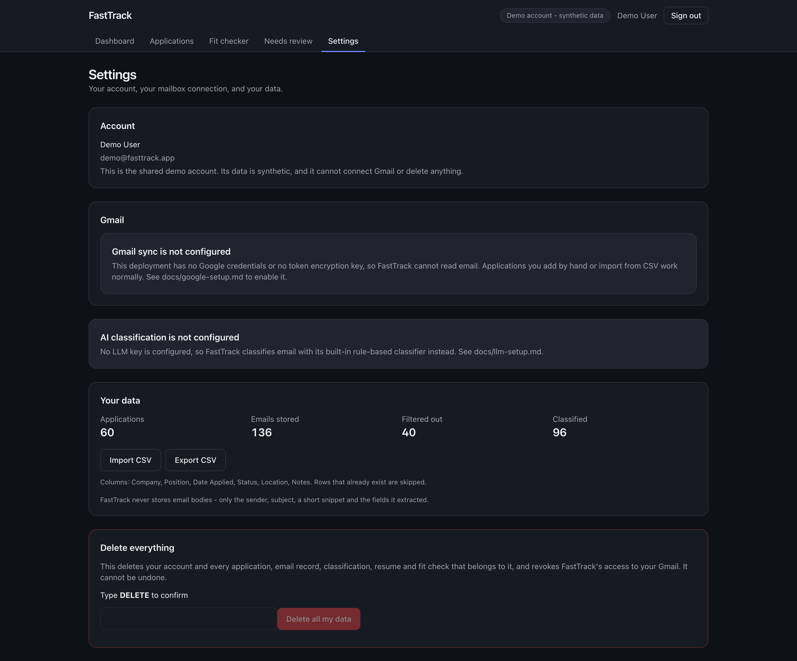
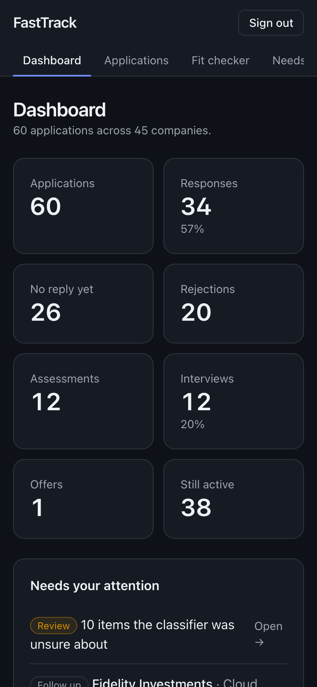

# FastTrack

**An internship application tracker that reads your email so you don't have to.**

[](https://github.com/OWNER/fasttrack/actions/workflows/ci.yml)

Java 21 · Spring Boot 3.5 · PostgreSQL 16 · Redis 7 · Next.js 16 · TypeScript · Docker



---

## Why I built this

I applied to more than 150 internships in one cycle. By January I could not
answer three basic questions: which companies had actually replied, which
online assessment was about to expire, and whether I had already been
rejected by a company I was about to email. The information was all sitting
in my inbox - 2,000 messages deep, in templates written by eight different
applicant tracking systems.

A spreadsheet needs constant manual upkeep, and I stopped updating mine in
week three. FastTrack does the upkeep itself: it reads the mail
(**read-only**), works out what each message means, and keeps every
application's status current - and before I apply anywhere else, it scores my
resume against the posting and tells me honestly where the gaps are.

## What it does

- **Reads job-application email** with read-only Gmail access. It cannot
  send, delete, label or modify anything, and message bodies are never
  stored.
- **Classifies every message** into one of ten categories - confirmation,
  rejection, assessment, interview request, offer, recruiter outreach, and so
  on - with a confidence score. Anything it is unsure about goes to a review
  queue instead of silently changing a status.
- **Keeps one application per company-and-role**, matching new mail to
  existing applications through requisition ids and normalized titles, so one
  role written three ways does not become three applications.
- **Records an append-only history**, so every status change links back to
  the email that caused it.
- **Scores your resume against a posting** with a deterministic, explainable
  hybrid score, and suggests only changes your resume can honestly support.
- **Works without Gmail and without an AI key.** Every feature that needs
  credentials says so plainly, and the rest keeps working.

## Try it

```bash
cp .env.example .env     # every variable is documented in the file
docker compose up --build
```

Open <http://localhost:3000> and press **Try the demo**: a seeded account
with 60 applications across 45 companies, 136 emails and a resume, so there
is something to look at immediately. No Gmail connection, no API key, no
sign-up.

## Screenshots

| | |
|---|---|
| **Applications** - searchable, filterable, with the status of each | **Application detail** - the full timeline, built from email |
|  |  |
| **Fit checker** - the score, and exactly how it was reached | **Needs review** - what the classifier was unsure about |
|  |  |
| **Settings** - connection state, what is stored, and how to delete it | **Mobile** - the layout is responsive, not a desktop page shrunk |
|  |  |

## Results

Every number here was produced by a command in this repository. Nothing is
estimated. [RESULTS.md](RESULTS.md) has the full setup and the exact
reproduction command for each one.

**Email classification** (200 labeled synthetic emails, deterministic path,
no API key):

| | |
|---|---|
| End-to-end accuracy | **96.5 %** (193/200) |
| Macro F1 across ten categories | **0.954** |
| Accuracy on the 89 hardest cases | **96.6 %** |
| Classifier errors caught by the review queue | **7 of 7** - no silent mistakes |
| Emails removed before any AI call | **9.5 %**, with zero job-related mail lost |

**Duplicate detection** (100 labeled application pairs):

| | |
|---|---|
| Precision | **1.000** |
| Recall | **1.000** |
| False merges | **0** |

The 0.60 similarity threshold was not chosen by taste: the evaluation sweeps
every candidate value and the table is in RESULTS.md.

**Fit scorer** (20 hand-labeled resume/posting pairs):

| | |
|---|---|
| Exact band agreement | **65 %** |
| Within one band | **100 %** |
| Suggestions that would have you claim something unevidenced | **0** |

**Performance** (full Docker stack, k6):

| Concurrent users | Requests/sec | Errors | Dashboard p95 |
|---:|---:|---:|---:|
| 50 | 352.9 | 0.00 % | 182 ms |
| 100 | 707.9 | 0.00 % | 327 ms |
| 250 | 897.6 | 0.00 % | 615 ms |

60,143 requests, zero failures. Sync throughput: **3,888 emails/minute**
through prefilter, classifier, matcher and database.

**Quality:**

| | |
|---|---|
| Tests | **437** passing (`mvn verify`), plus 3 evaluation harnesses and 7 Playwright end-to-end tests |
| Line coverage | **85.6 %**, gate at 80 % enforced in CI |
| Lighthouse | **100** performance and **100** accessibility on all four main pages |

## Engineering highlights

- **Degrades honestly.** No Gmail key, no AI key, no Redis - each failure has
  a defined behaviour and a test. The classifier falls back from LLM to a
  deterministic rule engine that is maintained as a first-class component and
  published as the baseline the LLM is measured against.
- **Nothing is marked rejected because it went quiet.** Silence is its own
  outcome everywhere in the product, including the funnel.
- **Measurement drove the design.** The matcher evaluation found three real
  normalization bugs; the fit-scorer evaluation found a JSON field-naming
  mismatch that had silently disabled *every* eligibility check. Both are
  written up in RESULTS.md rather than quietly fixed.
- **The honesty rule is enforced by a test.** No suggestion may ever tell you
  to add a skill, a technology or a number your resume does not evidence -
  asserted across every suggestion in the evaluation set.
- **Privacy by construction.** Read-only scope asserted by a test that fails
  if a write scope is ever added; bodies processed in memory and discarded;
  refresh tokens AES-256-GCM encrypted, with a flat refusal to store anything
  when no key is configured.
- **Isolation proven, not asserted.** A second account attempts every read
  and write against another user's application, resume, fit check and email;
  all 404, and the responses are scanned for leaked content.
- **The prompt is a versioned file**, and its version is part of the cache
  key - so a prompt change can never be mixed with results from the old one.

## Documentation

| Document | What it covers |
|---|---|
| [architecture.md](docs/architecture.md) | How the pieces fit, and why it is a monolith |
| [database.md](docs/database.md) | Schema, conventions, and the two uniqueness rules that matter |
| [api.md](docs/api.md) | Every endpoint, the auth handshake, error codes (plus Swagger UI at `/swagger-ui.html`) |
| [ai.md](docs/ai.md) | Prompts, schemas, fallbacks, caching, and the evaluation's caveats |
| [security.md](docs/security.md) | What is protected, how it is verified, what is not |
| [privacy.md](docs/privacy.md) | Exactly what is stored and what never is |
| [google-setup.md](docs/google-setup.md) | Free Gmail setup, step by step |
| [llm-setup.md](docs/llm-setup.md) | Groq free tier or local Ollama |
| [deployment.md](docs/deployment.md) | Two $0 deployment paths |
| [DECISIONS.md](DECISIONS.md) | Every engineering decision and its alternative |
| [RESULTS.md](RESULTS.md) | Every measured number and how to reproduce it |

## Testing

```bash
make verify          # backend tests + 80% coverage gate
make test-frontend   # typecheck and lint

cd backend && mvn -Peval test        # classifier, matcher and fit evaluations
cd frontend && npm run test:e2e      # Playwright, against a running stack
./scripts/run-load-tests.sh          # k6 at 50/100/250 users
cd frontend && npm run lighthouse    # Lighthouse, including signed-in pages
```

CI runs the backend suite with the coverage gate, the evaluation harnesses
(which also fail if the committed evaluation sets no longer match their
generators), the frontend checks, and the end-to-end suite against a real
Compose stack.

## Known limitations

- **The LLM path has not been measured yet.** Every number above comes from
  the deterministic fallback paths, because no API key has been configured.
  The harness is written and takes one environment variable.
- **The evaluation sets are synthetic and I wrote them.** Real application
  email cannot be committed - it is other people's data too. The classifier's
  phrase lists and the matcher's normalization rules were iterated against
  these sets, so those numbers are in-sample and should be read as an upper
  bound. The live-accuracy figure built from real corrections is the honest
  counterpart, and the product shows it with that caveat attached.
- **Google OAuth runs in Testing mode**, so refresh tokens expire after seven
  days and you reconnect weekly. The app reports this rather than failing
  quietly.
- **Not deployed yet.** Both paths are written up and the containers build;
  deploying needs an account only I can create.
- **Single-user by design.** It is isolated per user and tested for that, but
  it has not been reviewed as a hostile multi-tenant system.
- **`unsafe-inline` in the frontend CSP**, which Next.js needs without
  per-request nonces. It is the one Lighthouse deduction in the whole app.
- **Fit-versus-outcome needs data.** The dashboard will not claim the score
  predicts replies until at least eight fit checks are linked to
  applications.

## Demo account

`POST /api/auth/demo`, or the **Try the demo** button. Seeded with 60
applications, 136 emails, a resume and a non-empty review queue, all
generated from fixed seeds so the demo is identical on every machine. The
data is synthetic: invented messages against real company names, no real
person's mail.
